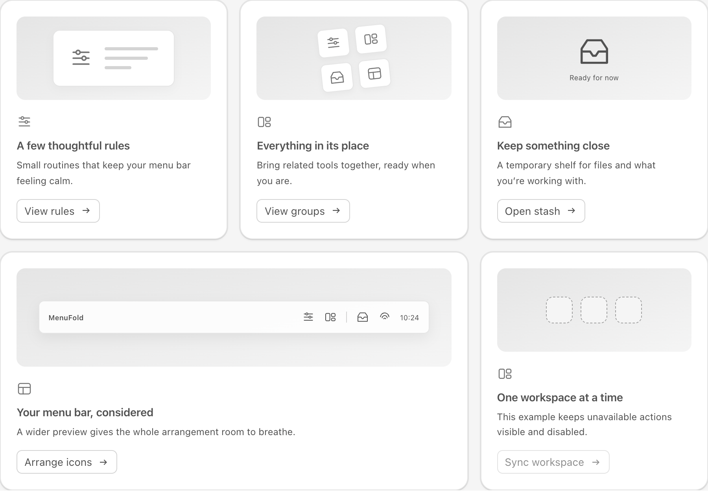
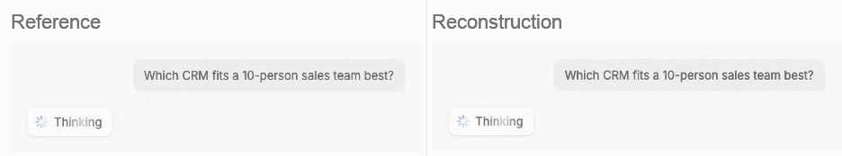
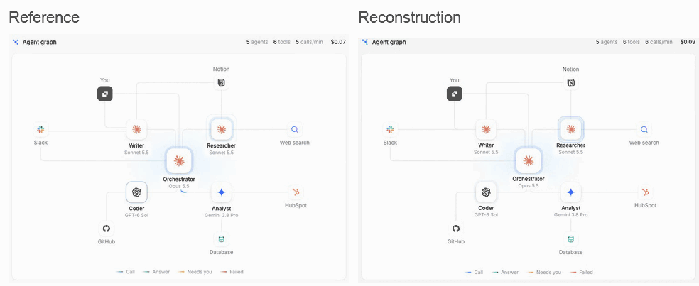
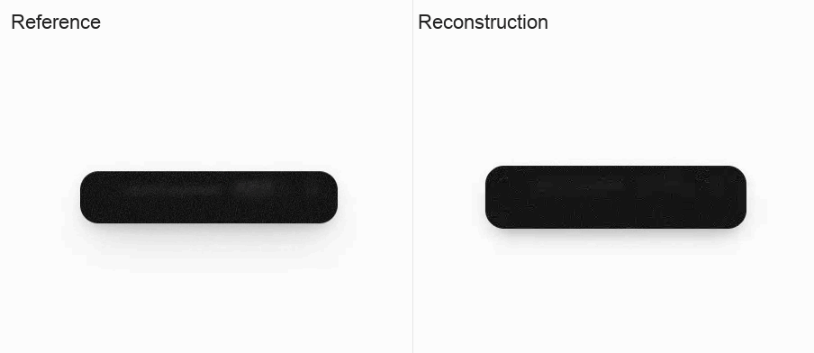
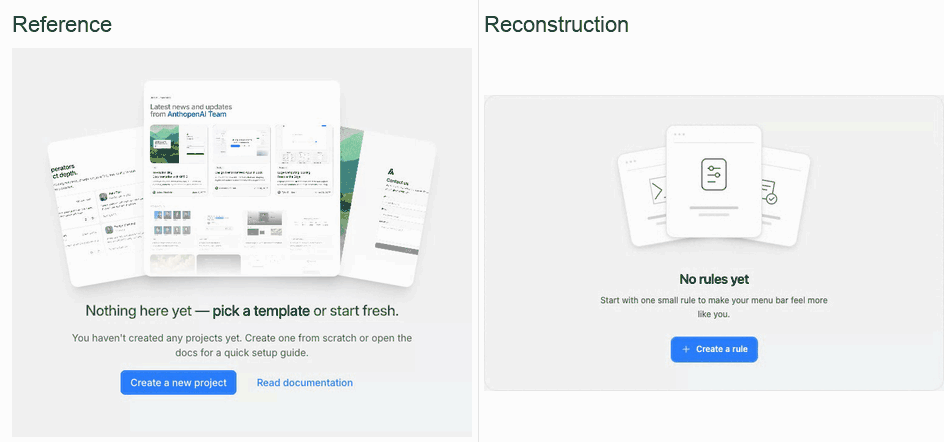
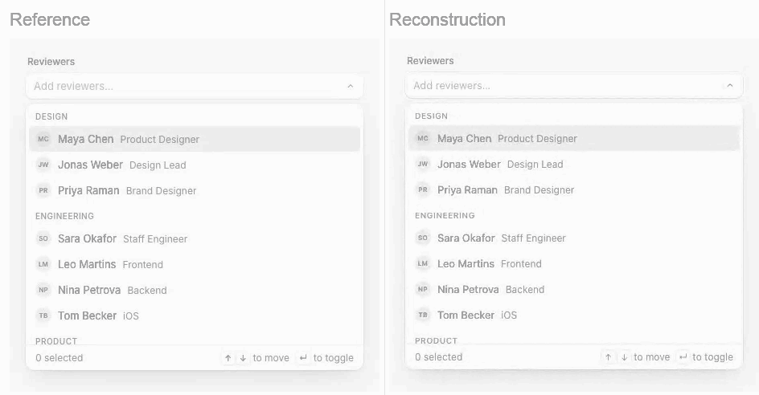
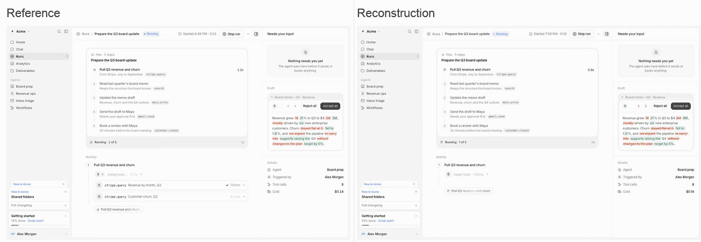
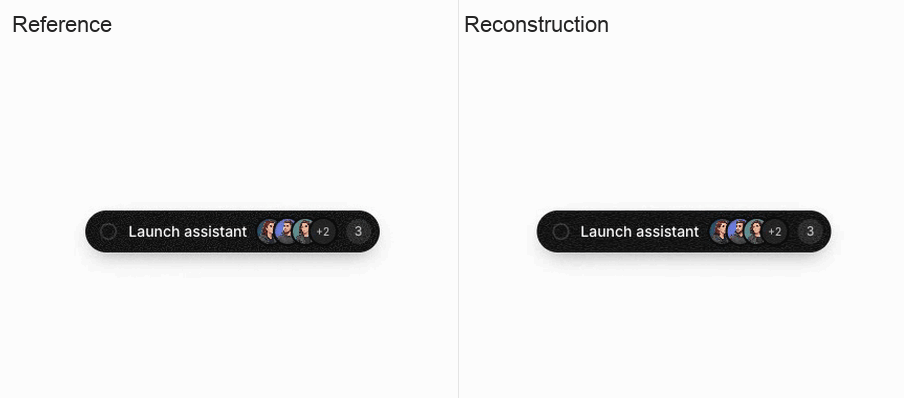

# UI Recast

**Rebuild UI from visual evidence.**

A self-contained coding-agent skill that turns screenshots, videos, and live URLs into editable UI components—with complete interaction capture and comparison of color, icons, light effects, and subtle transitions.

[Install](#install) · [Use the skill](#use-the-skill) · [Case showcase](#case-showcase) · [All cases](cases/README.md) · [Workflow](skills/ui-recast/SKILL.md) · [简体中文](README.zh-CN.md)



## From reference to reusable source

1. **Capture the whole interaction.** Include entrance, loops, phase changes, completion, exit, and retrigger.
2. **Separate the visual tracks.** Inspect icons, light, text, and layout; extract the reference's actual color roles.
3. **Rebuild and compare.** Align rendered phase starts, inspect real intermediate frames, and fix concrete omissions.
4. **Deliver the evidence.** Provide source, an interactive example, recordings, verified scope, and remaining differences.

Light and dark themes are analyzed separately: role palettes, icon visibility, composited light/texture, and supported theme changes. See the [theme comparison guidance](skills/ui-recast/references/verification-delivery.md#dark-mode-and-theme-changes).

The skill preserves caller-owned business state and user-requested product adaptations. Choose the project's web or native UI and animation mechanisms according to the reference and output platform.

## Case showcase

> **Models used:** `gpt6-astra` for the original collection; `gpt-6.1-sol` (`high`) for the Fluid Notch multi-step flow below. Other models have not been tested.

Reference on the left; reconstruction on the right. Each pair is **one automatically looping GIF**, so both sides play together. These are cropped, phase-aligned excerpts at original speed; full recordings remain linked below. The Fluid Notch excerpt joins opening and closing windows with short reading holds.

### Thinking Loader

Stationary rays, text sweep, phase handoffs, completion check.



[Full reference recording](cases/ui-lab/public/evidence/thinking-loader/motion-study/reference/clean/lifecycle.webm) · [Full reconstruction recording](cases/ui-lab/public/evidence/thinking-loader/motion-study/replica/clean/lifecycle.webm)

[Source](cases/ui-lab/src/components/thinking-loader.tsx) · [Review](docs/affectui-review/loaders.md)

### Agent Graph

Staggered nodes, breathing rings, status sweeps, call pulses.



[Full reference recording](cases/ui-lab/public/evidence/agent-graph/motion/reference/lifecycle.webm) · [Full reconstruction recording](cases/ui-lab/public/evidence/agent-graph/motion/replica/lifecycle.webm)

[Source](cases/ui-lab/src/components/agent-graph.tsx) · [Review](docs/affectui-review/loaders.md)

### Fluid Notch

Shell morphing, icon handoffs, texture, expansion and collapse.



[Full reference recording](cases/ui-lab/public/evidence/batch/fluid-notch/reference/lifecycle.webm) · [Full reconstruction recording](cases/ui-lab/public/evidence/batch/fluid-notch/replica/lifecycle.webm)

[Source](cases/ui-lab/src/components/fluid-notch.tsx) · [Review](docs/menufold-review/fluid.md)

### Stacked Empty State

Layered cards, light/shadow, hover, a single primary action.

The reconstruction is the MenuFold adaptation with native icons and one primary action.



[Full reference recording](cases/ui-lab/public/evidence/batch/stacked-empty-state/reference/lifecycle.webm) · [Full reconstruction recording](cases/ui-lab/public/evidence/batch/stacked-empty-state/replica/lifecycle.webm)

[Source](cases/ui-lab/src/components/stacked-empty-state.tsx) · [Review](docs/menufold-color/stack.md)

### Combobox

Independent chip expansion/pop, focus ring, armed deletion.



[Full reference recording](cases/ui-lab/public/evidence/batch/combobox/reference/lifecycle.webm) · [Full reconstruction recording](cases/ui-lab/public/evidence/batch/combobox/replica/lifecycle.webm)

[Source](cases/ui-lab/src/components/combobox.tsx) · [Review](docs/affectui-review/forms.md)

### Agent Run

Application shell, tool execution, status pulse, reading pane.



[Full reference recording](cases/ui-lab/public/evidence/batch/agent-run/reference/lifecycle.webm) · [Full reconstruction recording](cases/ui-lab/public/evidence/batch/agent-run/replica/lifecycle.webm)

[Source](cases/ui-lab/src/components/agent-run.tsx) · [Review](docs/affectui-review/shells.md)

[The case catalog](cases/README.md) contains **44 component entries and 2 composition examples**, including **15 MenuFold components**. Cases include independent visual reconstructions and attributed public-source adaptations. Detailed review notes currently retain their original language.

### Fluid Notch — multi-step flow

Three questions, progress updates, completion, reset, and interruptible expansion/collapse. Model: `gpt-6.1-sol` (`high`).



[Full reference recording](cases/model-trials/gpt-6.1-sol/fluid-notch/evidence/reference/lifecycle.webm) · [Full reconstruction recording](cases/model-trials/gpt-6.1-sol/fluid-notch/evidence/reconstruction/lifecycle.webm)

Standalone installation, build, and interaction checks passed. Remaining timing differences are documented in the [source and review](docs/model-trials/gpt-6.1-sol.md).

## Target platforms

The workflow starts from the requested output platform and existing project: web frameworks, SwiftUI, UIKit, AppKit, or another UI stack. Capture tools, state interfaces, animation mechanisms and runtime verification follow that choice. A web reference can be reconstructed in native Swift when requested.

The shipped component cases are React/TypeScript web implementations. Native SwiftUI/UIKit/AppKit reconstruction has not yet been validated by a native case in this repository. The optional `video_frames.py` extraction helper uses Python 3.9+ standard library and FFmpeg, independently of the component implementation language.

## Install

This repository is private; clone it using an account with access:

```sh
gh repo clone Damon-GSY/ui-recast
cd ui-recast
mkdir -p ~/.codex/skills
cp -R skills/ui-recast ~/.codex/skills/
```

The skill lives in [`skills/ui-recast/`](skills/ui-recast/SKILL.md). Its instructions and references are in English and require no other skill.

## Use the skill

```text
Use $ui-recast to rebuild this component: <reference URL>
Capture the complete interaction first. Compare colors, icons, light effects,
and subtle transitions, then deliver runnable source and reference comparisons.
Preserve my specified business state and interaction semantics.
```

Screenshots and videos are valid inputs too. With a single frame, timing and hidden interactions remain unverified rather than being presented as observed behavior.

## Extract video frames

Use Python 3.9+ and a full FFmpeg installation. The script needs no Python packages:

```sh
python3 skills/ui-recast/scripts/video_frames.py input.webm output-frames 12
```

Use `python` instead of `python3` if that is the Python 3 command on your host. Pass `--ffmpeg /path/to/ffmpeg` or set `FFMPEG` when needed. The helper writes native PNG frames and actual decoder timestamps; it does not interpolate or duplicate frames to meet the requested sampling rate.

## Run the case lab

Requires Node.js 22.12+ or a newer version supported by the included Vite release.

```sh
cd cases/ui-lab
npm ci
npm run dev -- --port 4187
```

Open `http://127.0.0.1:4187/batch`. Switch between live examples and paired recordings. The MenuFold collection is at `/batch?collection=menufold`; earlier examples include `/thinking-loader` and `/agent-graph`.

```sh
npm run build
npm run preview -- --port 4192
```

Reusable source is in `cases/ui-lab/src/components/`. Fixtures and example state live in `src/batch/` or `src/studies/`. Business actions remain the caller's responsibility.

## Reuse a component

Copy its TSX, CSS, and required relative dependencies. The included registry files list actual source bodies and dependencies. While the lab is running:

```sh
npx shadcn@4.23.0 add http://127.0.0.1:4187/r/fluid-notch.json
```

See the [integration notes](docs/menufold/source-delivery.md) for caller responsibilities. `DetailAccordion` also requires `auto-height.tsx` and `auto-height.css`.

## Evidence and limits

- [MenuFold motion review](docs/menufold-review/README.md) and [color review](docs/menufold-color/README.md) record fixes, installation checks, and verified behaviors.
- [AffectUI review](docs/affectui-review/README.md) retains delivered group findings; final acceptance of the entire additional batch remains unfinished.
- The exported lab passed an independent build and rendering checks for 46 routes, with no page errors or local resource 404s. See [the recorded result](docs/verification/standalone.json).
- Native recordings are 25fps. They do not establish millisecond or pixel-perfect equivalence. Product adaptations and remaining font, icon, and curve differences are documented per case.
- Reference previews, brands, and public-source assets retain their respective rights. Provenance is recorded in case analyses. No repository-wide open-source license has been assigned.
