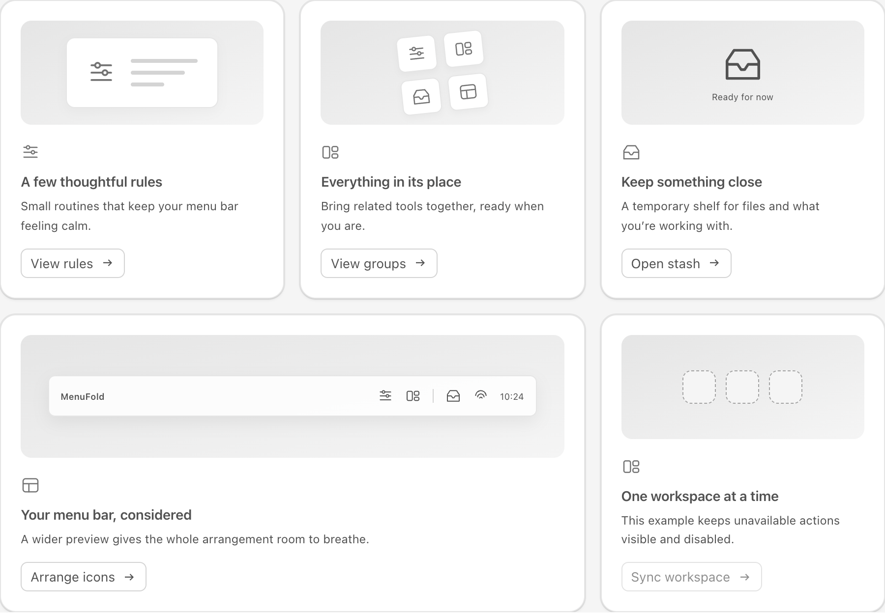
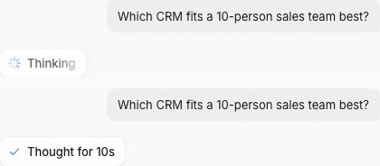
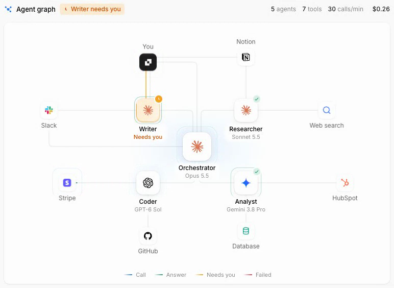
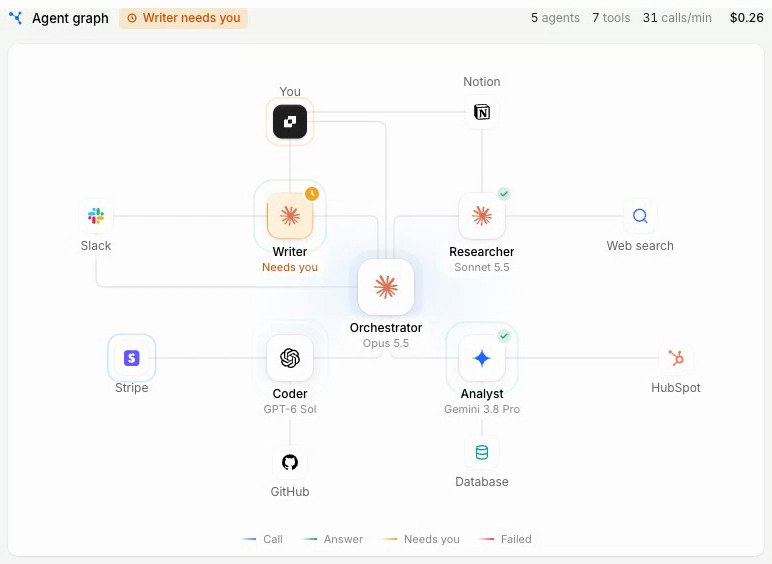
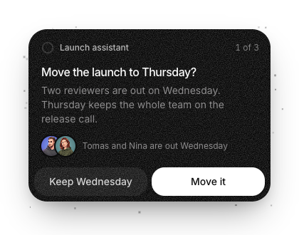
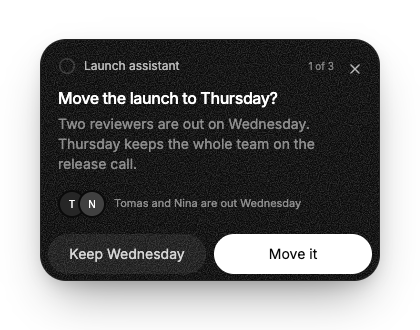
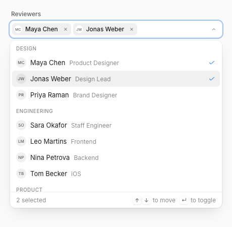
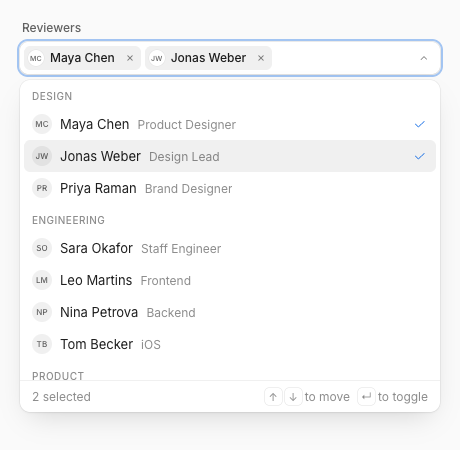
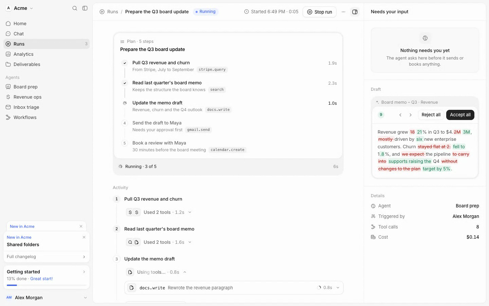
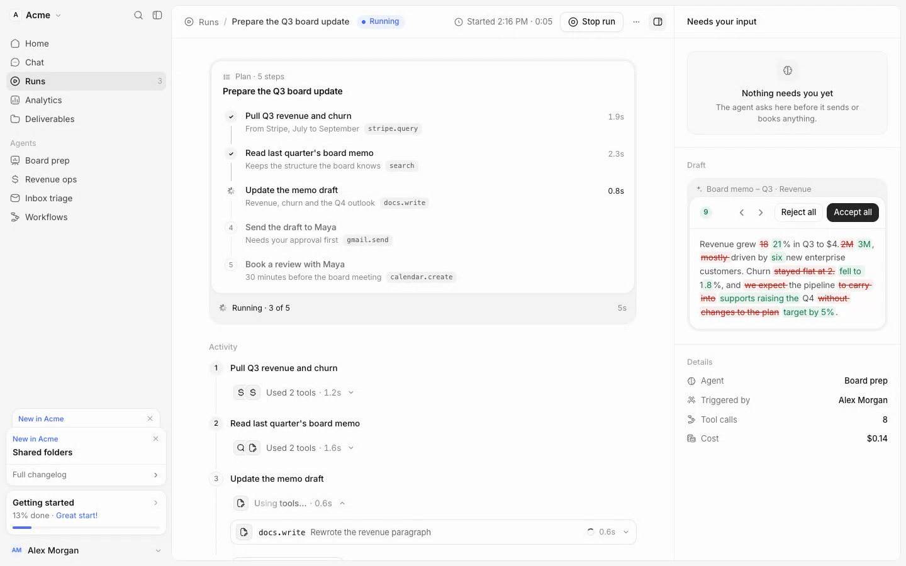

# UI Recast

从 **截图、视频或 URL** 重建可运行的 UI 组件，把颜色、图标、光效和细微过渡一起对照。

[安装 Skill](#安装与使用) · [查看案例](cases/README.md) · [读取工作流程](skills/ui-recast/SKILL.md) · [运行实验室](#运行案例实验室)



这个 skill 将参考采集、分轨分析、源码实现和真实对照串成一条流程。交付包含可编辑组件、独立用例、录屏与已验证范围，适合有明确参考目标的组件复刻。

## 案例先看这里

> **使用模型：**这里展示的复刻案例使用 `gpt6-astra` 完成，其他模型尚未测试。

左侧为参考，右侧为复刻。这里直接展示采集到的状态画面，完整动效可在案例实验室中对照。

### Thinking Loader

八条静止射线、文字扫光、阶段交接与完成勾标。

| 参考 | 复刻 |
| --- | --- |
|  |  |

[源码](cases/ui-lab/src/components/thinking-loader.tsx) · [复查](docs/affectui-review/loaders.md)

### Agent Graph

节点错峰入场、呼吸光环、等待/错误光扫与调用轨迹。

| 参考 | 复刻 |
| --- | --- |
|  |  |

[源码](cases/ui-lab/src/components/agent-graph.tsx) · [复查](docs/affectui-review/loaders.md)

### Fluid Notch

外壳变形、图标交接、纹理与展开/收回的中间态。

| 参考 | 复刻 |
| --- | --- |
|  |  |

[源码](cases/ui-lab/src/components/fluid-notch.tsx) · [动效复查](docs/menufold-review/fluid.md)

### 叠层空状态

卡片叠层、光影、悬停与单一主要操作。

右侧为 MenuFold 适配版，采用原生图标并保留一个主要操作。

| 参考 | 复刻 |
| --- | --- |
|  |  |

[源码](cases/ui-lab/src/components/stacked-empty-state.tsx) · [配色复查](docs/menufold-color/stack.md)

### Combobox

标签外壳展开与内容 pop 分轨，焦点光环及退格选中。

| 参考 | 复刻 |
| --- | --- |
|  |  |

[源码](cases/ui-lab/src/components/combobox.tsx) · [复查](docs/affectui-review/forms.md)

### Agent Run

任务外壳、工具过程、状态脉冲与内容阅读区。

| 参考 | 复刻 |
| --- | --- |
|  |  |

[源码](cases/ui-lab/src/components/agent-run.tsx) · [复查](docs/affectui-review/shells.md)

[完整案例目录 →](cases/README.md) 包含当前实验室的 **44 个源码条目**，其中 MenuFold 为 **15 个组件**。部分为公开源码适配，部分按公开渲染结果独立实现；各项来源和边界见单项分析。

## Skill 怎样工作

1. **锁定目标**：确定区域、主题、变体、视口和技术栈，记录用户明确的产品改动。
2. **完整采集**：录下触发前、入场、循环、阶段切换、完成/退出和再次触发。
3. **按轨道分析**：分别观察图标、光效、文字、布局；颜色按背景、表面、文字、边框与状态角色取证。
4. **实现与对照**：相同条件下录制复刻，按实际渲染起点对齐；检查起步、中段、过冲和稳定态。
5. **交付源码**：提供组件、样式、用例、媒体与余差；需要分发时再做独立安装和运行验证。

Skill 的指导内容自包含。动效引擎和基础控件由项目与参考决定，可采用 CSS、Motion 或 GSAP。

## 安装与使用

先克隆这个私有仓库，需要有仓库访问权限：

```sh
gh repo clone Damon-GSY/ui-recast
cd ui-recast
mkdir -p ~/.codex/skills
cp -R skills/ui-recast ~/.codex/skills/
```

在 Codex 中调用：

```text
使用 $ui-recast 复刻这个组件：<参考 URL>
先采集完整交互，分析颜色、图标、光效和 transition，
再交付可运行源码与原版/复刻对照。保留我指定的业务状态与交互语义。
```

也可以提供截图或视频。单帧无法证明隐藏交互和动画时序；skill 会将观察与推断分别记录。

## 运行案例实验室

需要 Node.js 22.12+（或支持当前 Vite 的更新版本）。

```sh
cd cases/ui-lab
npm ci
npm run dev -- --port 4187
```

打开 `http://127.0.0.1:4187/batch`，选择实时演示或双录像对照。MenuFold 集合入口为 `/batch?collection=menufold`；Thinking Loader 与 Agent Graph 分别位于 `/thinking-loader`、`/agent-graph`。

```sh
npm run build
npm run preview -- --port 4192
```

可复用源码位于 `cases/ui-lab/src/components/`，演示状态与样本位于 `src/batch/` 或 `src/studies/`。业务动作由调用方提供；演示成功、计时或模拟状态不代表后端接入。

## 取用组件

复制同名 TSX 和 CSS，按依赖安装 React 与 Motion。组合依赖保存在 `cases/ui-lab/public/r/<name>.json` 中；实验室运行后也可通过真实 registry 安装：

```sh
npx shadcn@4.23.0 add http://127.0.0.1:4187/r/fluid-notch.json
```

参数和宿主责任见 [MenuFold 源码接入说明](docs/menufold/source-delivery.md)。`DetailAccordion` 同时依赖 `auto-height.tsx` 和 `auto-height.css`。

## 证据与边界

- [MenuFold 动效复查](docs/menufold-review/README.md)与[配色复查](docs/menufold-color/README.md)：包含修复、真实安装和相关行为验证。
- [AffectUI 分组复查](docs/affectui-review/README.md)：保留本轮实际发现和分组结果，整批最终验收尚未完成。
- 录像与关键帧用于判断当前已采集范围；原生视频为 25fps，不能据此宣称逐毫秒或逐像素一致。
- 部分案例保留明确的产品适配，字体、图标或曲线仍可能有已记录差异；不作统一 1:1 承诺。
- 原站预览、品牌资源与公开源码的权利归各自权利人；具体来源见单项分析。本仓库尚未设定统一开源许可。

